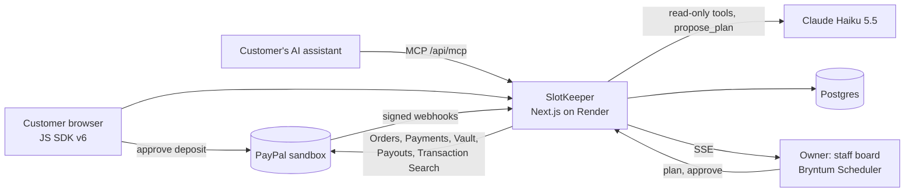

# SlotKeeper

AI assistants are starting to book appointments for people, and small businesses eat the no-shows.
SlotKeeper makes every booking, human- or agent-made, payment-backed with PayPal, and lets the owner
describe a change in one sentence while an AI copilot plans the day, the owner approves, and every
money action is audited.

**Live demo:** https://slotkeeper-93dy.onrender.com · built for the PayPal AI Hackathon, **PayPal sandbox only** (no real money moves).

## What it does

- **Deposit holds.** A customer books a slot and PayPal holds a deposit on their account (Orders v2 `AUTHORIZE`, JS SDK v6). Nothing is charged yet.
- **Money actions for the owner.** Capture the whole deposit when the service happened, charge a no-show fee (partial capture, the rest of the hold is released), void the hold, or refund, from buttons on the staff board that each ask for confirmation. Reauthorizing a hold is an API route and a copilot step.
- **Live staff board.** A Bryntum Scheduler day view coloured by deposit state; PayPal webhooks and staff actions update it live.
- **Owner copilot.** The owner types what changed ("Maria is sick tomorrow, move her clients to Ken"). Claude reads the bookings with read-only tools and proposes a plan. The plan is previewed on the schedule, checked in code, and runs only after the owner approves. Every step is written to an audit log with its PayPal ids.
- **Bookings by customers' AI assistants.** An MCP server (`/api/mcp`) lets an assistant search slots, hold one and get a PayPal approval link. The customer approves the deposit in PayPal themselves; the assistant never moves money.
- **Saved wallet.** A customer can opt in to save their PayPal wallet (Vault) so a no-show fee can be charged later, once, without them present.
- **End-of-day payouts.** One PayPal Payouts batch pays each staff member their commission. (The batch format already carries tips, but nothing creates tips yet.)
- **Deposits report.** Captured deposits, no-show fees and refunds from PayPal Transaction Search.

## How it meets the judging criteria

**Technical implementation.**
PayPal is the core, not an add-on: eight PayPal capabilities are used for real business needs (table below), and the interesting work is making money movement safe.
- Every money call carries a stable `PayPal-Request-Id`, so a retry replays PayPal's stored answer instead of acting twice. When an outcome is unknown (timeout, 5xx, dropped connection) the action is kept as pending and replayed with the same id; a replay is only abandoned before PayPal forgets the id (6 hours on Orders, 45 days on Payments), and then it goes to staff review instead of risking a second charge.
- Per-booking locks and a per-record revision in Postgres stop two requests, or two server instances during a deploy, from overwriting each other's money records.
- Webhook signatures are verified locally; the payload is only a pointer, and the object is re-read from PayPal under the booking's lock.
- A day's payout batch is frozen before it is sent and only paid after the day is over, so money that settles late is not missed or paid twice.
- The copilot's read tools never show the model a vault, PayPal customer, order or authorization id (a test checks this), and the model has no tool that moves money.
- 579 unit tests run against the real SDK over a stubbed HTTP adapter (no network), plus an opt-in suite that sends `PayPal-Mock-Response` to the real sandbox to check declines and expiries. The flows were also run against the PayPal sandbox: authorize, no-show capture, refund, void, saved-wallet charge, a payout batch and webhook deliveries.

**Design.**
The owner's day is one screen: bookings coloured by deposit state (due, held, captured, no-show, refunded, needs review, released), a live indicator, and the copilot beside it. A proposed plan appears on the schedule before anything runs: a dashed ghost where a booking would go, the original faded, and a note on every booking whose money would move ("Will release hold", "Will charge $4.00"). The money the owner approves is shown as the same amount the payment layer will use.

**Potential impact.**
Small appointment businesses (salons, physio, tutoring, pet grooming) lose revenue to no-shows and last-minute cancellations, and they run on thin staff and no back office. A deposit hold makes the commitment real without charging customers who show up, and the copilot turns the painful part, re-planning when someone is out, into one sentence plus one approval. The MCP server prepares the same business for customers who book through an AI assistant. PayPal's own [AI resources page](https://developer.paypal.com/ai-tools/get-started) lists service businesses that invoice, take payments and manage appointments as a typical use of its AI tools.

**Creativity and innovation.**
Deposits and no-show fees already exist. What is new is the agent layer around them: (1) a booking channel for customers' AI assistants where the assistant reserves and the human approves the PayPal payment; (2) a copilot whose output is a plan, not an action, previewed on the schedule and executed only after approval, with the audit trail tying each step to PayPal transaction ids; (3) holds, partial captures and a saved wallet combined so a no-show fee can be charged without ever exceeding the deposit. PayPal's [agent tools reference](https://developer.paypal.com/ai-tools/agent-tools) (read on 2026-11-04) has no tool for authorize, void, reauthorize, Payouts or Vault, and its `pay_order` captures an authorized order by order id alone, with no amount. SlotKeeper builds those money tools itself on the Server SDK. The reference also says PayPal's remote MCP commerce tools cover gift cards only; SlotKeeper's MCP server brings service booking to the same idea.

**Presentation.**
This README, [`docs/devpost.md`](docs/devpost.md) and the steps below are written so the project can be evaluated without running it; the live demo needs only a PayPal sandbox personal account.

## Architecture



## PayPal integration (API → code)

| PayPal capability | What it is used for | Code |
|---|---|---|
| JS SDK v6 | Customer approves the deposit hold (optionally saving the wallet) | `components/DepositCheckout.tsx` |
| Orders v2 | Create the deposit order (`AUTHORIZE`) and authorize it after approval | `lib/paypal/deposits.ts` |
| Payments v2 | Capture (full or partial no-show fee), void, reauthorize, refund; read-back of authorizations, captures and refunds | `lib/paypal/deposit-actions.ts`, `lib/paypal/webhook-events.ts` |
| Vault | Save the wallet at checkout, then a merchant-initiated charge with the vault id | `lib/paypal/deposits.ts`, `lib/paypal/deposit-actions.ts` |
| Payouts (REST) | End-of-day commission batch, paid by email | `lib/paypal/payouts.ts`, `lib/paypal/rest.ts` |
| Transaction Search | Deposits, no-show fees and refunds report | `lib/paypal/transaction-report.ts` |
| Webhooks | Signature verification, then settle the booking and push it to the staff board | `lib/paypal/webhook-signature.ts`, `lib/paypal/webhook-events.ts`, `app/api/webhooks/paypal/route.ts` |
| `PayPal-Request-Id`, `PayPal-Mock-Response` | Idempotent retries; negative testing against the sandbox | `lib/paypal/deposit-actions.ts`, `tests/sandbox/` |

The AI parts: the owner copilot in `lib/copilot/` (Claude, plan → approve → audited execution) and the MCP booking server in `lib/agent/mcp-server.ts`.

## Try it (for judges)

You need a **PayPal sandbox personal account** (your own, from developer.paypal.com > Testing tools > Sandbox accounts). No credentials of ours are needed to book. The time box uses your browser's local time, while the confirmation page and the report show UTC. Bookings can be at most 3 days ahead, because PayPal holds an authorization for 3 days.

1. Open https://slotkeeper-93dy.onrender.com/book, pick a service, type a nickname in the **Your name** field (bookings are shared and shown on the staff board) and choose a time within 3 days.
2. Click **Book and hold deposit**, then pay with the PayPal button using your sandbox personal account. The page then shows "Deposit held" with the PayPal authorization id.
3. The staff screens need a token (`STAFF_API_TOKEN`), given in the Devpost "Testing instructions". Open `/staff`, enter it, and your booking is on the board, coloured "Deposit held".
4. Click your booking on the board. The **Booking** tab shows its deposit and only the money actions that deposit allows right now: **Capture $…** (the whole deposit), **Charge no-show fee** (any amount up to the deposit; the rest of the hold is released), **Release hold**, then **Refund**, and **Charge saved wallet** once the booking is completed or charged a no-show fee, if the customer saved their wallet and part of the deposit was not captured. Each asks for confirmation first. The same actions are API routes (`Authorization: Bearer <token>`) for scripts:
   ```bash
   # whole deposit, service happened
   curl -X POST https://slotkeeper-93dy.onrender.com/api/bookings/<id>/deposit/capture -H "Authorization: Bearer <token>" -H "Content-Type: application/json" -d '{"reason":"completed"}'
   # no-show fee of $4.00, the rest of the hold is released
   curl -X POST .../deposit/capture ... -d '{"reason":"no_show","amountCents":400}'
   # release the hold, or refund what was captured
   curl -X POST .../deposit/void ... ;  curl -X POST .../deposit/refund ... -d '{}'
   ```
   The board shows the result at once, and again when PayPal's webhook confirms it.
5. In the copilot panel on `/staff`, describe a change, for example "Cancel Ana's booking and release her deposit". The copilot proposes a plan that is previewed on the schedule; **Approve and run** executes it and the **Audit log** tab lists each step with its PayPal ids.
6. MCP: point an MCP client at `https://slotkeeper-93dy.onrender.com/api/mcp` (Streamable HTTP, no authentication; each booking has its own token). Tools: `search_slots`, `hold_slot`, `create_deposit`, `cancel_booking`, `booking_status`.

## Run locally

Requires Node.js 20.9 or newer.

```bash
npm install
cp .env.example .env.local   # then fill in your sandbox client ID and secret
npm run dev
```

Open http://localhost:3000/api/health. `{"ok":true,...}` means the PayPal sandbox credentials work.
The check only requests an OAuth token; it creates nothing and moves no money.

**Troubleshooting: `UNABLE_TO_VERIFY_LEAF_SIGNATURE` / "TLS certificate could not be verified".**
Antivirus software (AVG, Avast, …) or a corporate proxy that inspects HTTPS re-signs traffic
with its own certificate, which Node doesn't trust by default. Start the server so Node uses the
Windows certificate store, where that certificate is installed (on Node 22 the
`NODE_USE_SYSTEM_CA` variable is ignored; the `--use-system-ca` flag works):

```powershell
$env:NODE_OPTIONS = '--use-system-ca'; npm run dev
```

```bash
npm test          # unit tests (no network)
npm run typecheck
npm run build
```

### Sandbox negative tests

`npm test` never touches the network. An opt-in suite calls the real PayPal sandbox with the `PayPal-Mock-Response` header and fake ids, so no money moves. Turn on Negative Testing for the sandbox business account first, then:

```powershell
$env:PAYPAL_SANDBOX_TESTS = '1'; $env:NODE_OPTIONS = '--use-system-ca'; npm run test:sandbox
```

It needs Node 22.15 or later, reads `.env.local`, and refuses to run against production. Without `PAYPAL_SANDBOX_TESTS=1` every test is skipped.

## Environment variables

| Variable | Required | Purpose |
|---|---|---|
| `NEXT_PUBLIC_PAYPAL_ENVIRONMENT` | yes | `sandbox` (default). `production` is refused unless `PAYPAL_ALLOW_PRODUCTION=true` |
| `NEXT_PUBLIC_PAYPAL_CLIENT_ID` | yes | Sandbox app client ID (public: the browser SDK needs it) |
| `PAYPAL_CLIENT_SECRET` | yes | Sandbox app secret (server only) |
| `STAFF_API_TOKEN` | for staff features | Bearer token for the staff board and money actions |
| `PAYPAL_WEBHOOK_ID` | for webhooks | Webhook ID of the app; without it deliveries are refused |
| `DATABASE_URL` | recommended | Postgres. Without it data stays in memory and is lost on restart |
| `ANTHROPIC_API_KEY` | for the copilot | Server-side key; without it only the copilot is disabled |
| `COPILOT_MODEL` | no | `claude-haiku-5-5` (default), `claude-sonnet-5-5` or `claude-opus-5-5` |
| `COPILOT_DAILY_LIMIT` | no | Copilot requests per rolling 24 hours, 1 to 1000 (default 40). Kept in memory, so a restart starts the count again |
| `STAFF_PAYOUT_EMAILS` | for payouts | `maria=<email>,ken=<email>` (sandbox personal accounts) |
| `BUSINESS_TIME_ZONE` | no | IANA zone that decides the business day (default `UTC`; Render sets `America/Los_Angeles`) |
| `APP_URL` | when deployed | Public URL for PayPal return and cancel links |
| `PAYPAL_TIMEOUT_MS` | no | Per-request timeout, default 15000, at most 60000 |

## Deploy (Render)

[`render.yaml`](render.yaml) is a Render Blueprint: in Render choose **New > Blueprint**, pick this
repository, and fill in the values it asks for (all from the PayPal sandbox app, plus a staff token
you generate). PayPal webhooks need the public URL, so they are set up after the first deploy:

1. In developer.paypal.com > Apps & Credentials > your sandbox app > **Add Webhook**, use
   `https://<your-service>.onrender.com/api/webhooks/paypal` and subscribe to
   `CHECKOUT.ORDER.APPROVED`, `PAYMENT.AUTHORIZATION.CREATED`, `PAYMENT.AUTHORIZATION.VOIDED`,
   `PAYMENT.CAPTURE.COMPLETED`, `PAYMENT.CAPTURE.DECLINED`, `PAYMENT.CAPTURE.PENDING` and
   `PAYMENT.CAPTURE.REFUNDED`.
2. Copy the Webhook ID into the service's `PAYPAL_WEBHOOK_ID` environment variable.

The build uses webpack (`npm run build`): Turbopack needed far more memory than Render allows a build.

The Blueprint also creates a Postgres database and sets `DATABASE_URL`. Bookings, payout batches,
copilot plans and the audit log are saved there and loaded back at startup. Reads stay in memory and
writes are queued, so the app runs as **one instance**; money flows wait for their write before they
answer. If `DATABASE_URL` is set but the database can't be read, the server refuses to start rather
than showing an empty schedule. Without `DATABASE_URL` (local development) data stays in memory.

During a deploy the old and new instance overlap for a moment, so every record carries a revision.
A save based on an old revision never overwrites a newer one: the newer version stays, the losing one
is kept as a `conflict` record, and the booking or payout batch goes to staff review. A money flow
re-reads its record when it takes the lock, and that record then stays fixed until the lock ends.
Each instance picks up the other's changes every 10 seconds, so for up to 10 seconds a new booking on
one instance is invisible to the other, and the same slot could be booked twice in that window.
`render.yaml` leaves auto-deploy off, so deploys happen at a quiet moment.

This protects releases that have revisions. Release f76ebfa and earlier write without any check: a
trigger makes their writes visible to newer instances, but they can still overwrite a newer save
unnoticed. So the first deploy with a database, or a rollback to such a release, needs a quiet moment.

## Staff board

`/staff` is the owner's day, built on a [Bryntum Scheduler](https://bryntum.com/products/scheduler/)
(trial package, so it shows a watermark). Open it with the staff token.

- Bookings are coloured by deposit state and update live over Server-Sent Events, from PayPal webhooks as well as staff actions.
- Clicking a booking opens the **Booking** tab: its deposit, and buttons for only the money actions that deposit allows right now. Each one asks for confirmation; amounts accept `4.50` or `4,50` and refuse ambiguous input such as `4,500`.
- The copilot panel previews a plan on the schedule before anything runs: a dashed ghost at the destination, a faded original, and a note for each money step. Nothing moves until the owner approves.
- The audit log lists every action the copilot ran, with its PayPal ids.

The copilot needs `ANTHROPIC_API_KEY` and runs on Claude Haiku 5.5 unless `COPILOT_MODEL` names
`claude-sonnet-5-5` or `claude-opus-5-5`. It only reads bookings and proposes a plan; the plan is checked
in code and runs only after the owner approves it. Haiku has no server-side refusal fallback, so a
request its safeguards decline is reported as such, and Sonnet and Opus get the fallback.

## How the PayPal integration is built

- `@paypal/paypal-server-sdk` 2.5.0, one shared client per server process (`lib/paypal/client.ts`).
- Explicit 15 s timeout and retries for idempotent methods only. The SDK's generated defaults are
  "no timeout" and "no retries"; money-moving POSTs are never re-sent by the SDK.
- Credentials come only from environment variables. The client secret is server-only.

### APIMatic Context Plugin

The PayPal Server SDK code is written with Claude Code and the
[APIMatic Context Plugin for PayPal](https://github.com/paypaldev/server-sdk-context-plugin-preview)
(`paypal:typescript-*` skills). The prompts are in [`docs/apimatic-prompts.md`](docs/apimatic-prompts.md).
Things the plugin caught that a generic model would have missed:

- The SDK's default timeout is `0` (wait forever) and retries are off unless
  `maximumRetryWaitTime` is also raised.
- `OAuthProviderError` imported from the package root is a same-named enum, not the error class,
  so `instanceof` silently fails; errors are matched on `ApiError` and the status code instead.
- Error payload fields keep PayPal's wire names (`error_description`), not camelCase.

## License

MIT — see [LICENSE](LICENSE).
